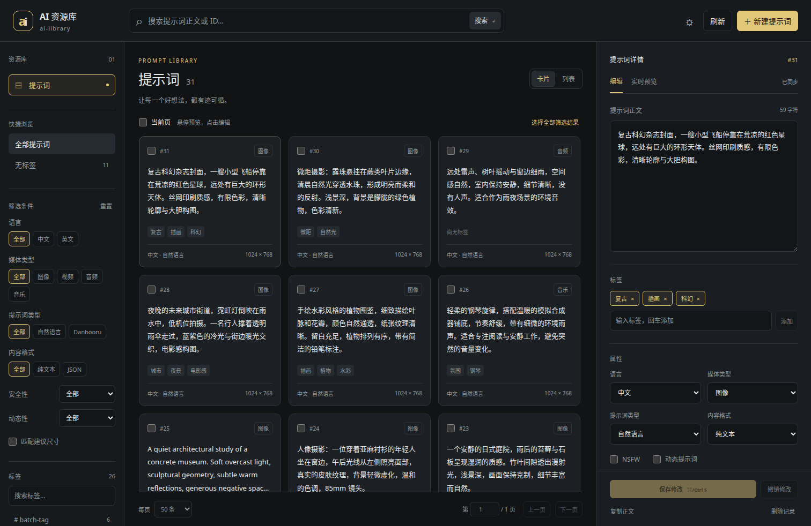

# ai-library · AI 资源库

独立管理可复用的 AI 资源。第一版提供提示词浏览、编辑、标签整理及 ComfyUI API；skill 和提示词模板将作为独立资源模块扩展。

前端采用 Vue 3 / TypeScript / Vite，后端采用 FastAPI / SQLite。只有服务端访问数据库，ComfyUI 节点通过 HTTP API 读写。



## Docker Compose 启动

需要 Docker Compose 和 Make。默认仅在宿主机 `127.0.0.1:8765` 提供页面和 API。

```bash
make image
make run
```

无需创建 `.env`、手动建目录或设置环境变量。默认使用 Docker 持久化数据卷保存数据库，第一次启动自动初始化空库；重复启动保留已有数据。

`make image` 构建镜像；`make run` 在后台启动服务，等待健康检查通过并显示容器状态。后续启动直接执行 `make run`。Dockerfile 内部的固定数据库位置和静态资源路径由镜像管理，无需用户配置。

打开 <http://127.0.0.1:8765>。页面和 API 同源，运行时不需要外部字体或图片服务。

### 接管现有数据库

默认数据卷适用于新库。只有接管外部已有库时，才需要一次性指定位置：先停止旧节点、导入脚本及其他数据库写入进程，创建 `.env`：

```dotenv
PROMPT_DATA_DIR=/absolute/path/to/database-directory
```

这不是每次启动需要传入的参数，Compose 会自动读取并在后续启动中沿用。默认文件名为 `prompts.sqlite3`；文件名不同时再增加 `AI_LIBRARY_DB_NAME=your-file.sqlite3`。当前已有 `.env` 的所有配置继续兼容，不会被新的默认值覆盖。

确认目录与文件路径正确后执行 `docker compose run --rm --no-deps ai-library ai-library migrate`，再执行 `make run`。旧库不会自动迁移。迁移先检查完整性，并通过 SQLite backup API 生成同目录带时间戳的完整备份，再移除旧 `shasum` 唯一约束、补齐校验值并添加索引和服务版本信息；保留原 ID、标签关联、重复正文及自增序列。

默认数据卷自动处理容器用户写入权限。外部目录挂载才需要确保权限匹配；拥有者不是默认的 `1000:1000` 时，在 `.env` 中增加对应的 `AI_LIBRARY_UID`、`AI_LIBRARY_GID`。挂载整个数据目录，数据库及 WAL、SHM、备份文件均需要可写，使用本地文件系统。

服务只自动创建不存在的新数据库。已有空文件、损坏或不兼容的旧库会报错，必须确认后显式迁移。迁移失败回滚当前事务并保留备份；成功后更新数据代际标识，使离线导入或恢复旧备份后的节点缓存失效。其他可选高级覆盖见 `.env.example`，常规启动不需要这些项。

### 备份与恢复

```bash
docker compose exec ai-library ai-library backup
```

命令输出备份的容器内路径，默认数据卷中的备份可通过 `docker compose cp ai-library:/data/<备份文件名> ./` 取出；外部目录挂载时，备份直接位于该目录。恢复时先停止服务和全部写入进程，保留当前数据库及其 `-wal`、`-shm` 文件以便排查，再用指定备份替换数据库文件；不要把旧库的 WAL、SHM 搭配恢复后的数据库使用。恢复后重新启动并检查 `/api/v1/health`。

### 远程访问

在自己的电脑上执行：

```bash
ssh -N -L 8765:127.0.0.1:8765 user@server
```

浏览器仍打开 <http://127.0.0.1:8765>。第一版无账号系统，不要把宿主机端口改为公网监听。

## ComfyUI 接入

配套的 ComfyUI-ToolBox 中 `tb-random-prompt`、`tb-prompt-writer` 保持原有节点类型、参数及端口，仅访问方式改为 API。

**同机直接运行时无需配置。** 节点默认连接 `http://127.0.0.1:8765`，超时默认 30 秒。

ComfyUI 在 Docker 或其他机器时，在其全局侧栏“AI 资源库”中填写服务器可访问的 API 地址，点击“保存连接设置”，再点击“测试连接”。设置写入 ComfyUI 用户目录的 `ai-library/connection.json`，下一次节点执行即生效，重启后继续使用；不需要 `export` 或重建容器。只需持久挂载正常的 ComfyUI 用户目录。

同一 Docker 网络中填写 `http://ai-library:8765`。首次部署需让 ComfyUI 加入该网络：

```bash
docker network connect ai-library YOUR_COMFYUI_CONTAINER
```

为避免重建容器后丢失网络关系，可在 ComfyUI 的 Compose 中一次性声明外部网络：

```yaml
services:
  comfyui:
    networks:
      - default
      - ai-library
networks:
  ai-library:
    external: true
```

浏览器地址与 API 地址分别配置：侧栏“打开 AI 资源库”使用 ComfyUI 设置中的“AI 资源库：浏览器访问地址”，默认仍为 `http://127.0.0.1:8765`；服务器 API 地址在侧栏连接表单中保存。浏览器不需要访问容器域名。

旧环境变量 `AI_LIBRARY_API_URL`、`AI_LIBRARY_TIMEOUT_SECONDS` 继续兼容，优先于保存的设置；侧栏会提示哪些变量正在覆盖配置。新部署不需要设置它们。

节点不挂载数据库。连接失败、超时和 API 错误会直接报错，不回退到本地库；写请求不自动重试。写入超时后先检查记录，再决定是否重新执行。

## 使用

- 卡片与紧凑列表可切换，支持正文子串搜索、精确 ID 搜索、属性筛选、多标签全部匹配及“无标签”快捷筛选。数字搜索文本按 ID 处理。
- 悬停或键盘聚焦只读预览；点击卡片编辑。输入仅修改草稿，保存后生效。支持 `Ctrl/Cmd+S`；离开未保存草稿时可以保存、放弃或取消。
- 标签自动转小写、去重。输入标签后回车、逗号或离开输入框完成添加；清空全部胶囊可移除所有标签。
- 支持跨页勾选，或选择全部筛选结果。批量追加、移除、替换及删除都先预览数量，再确认提交。修改筛选条件会清空选择。
- 预览凭据有效期 10 分钟；目标集合、记录内容、标签或操作参数变化后必须重新预览。服务重启也会使凭据失效。批量操作完整提交或完整回滚。
- 单条编辑使用版本指纹保护。冲突时保留本地草稿，确认放弃或复制草稿后再重新加载。
- 随机节点使用 ID 升序及 `seed % 匹配数量` 的原有规则；数据版本变化会触发下次重新读取。JSON API 完整保留 Python 的 64 位 seed。
- 管理页新建总是生成新 ID，允许重复正文；writer 的 `id=0` 更新相同 SHA-1 中最小 ID 的记录，否则新增。指定 ID 只更新该记录，ID 不存在则报错。编辑器保留创建时间，writer 保留历史的写入时间行为。

## API

交互文档：<http://127.0.0.1:8765/docs>。所有资源接口位于 `/api/v1`。

| 接口 | 说明 |
| --- | --- |
| `GET /health` | 服务和数据库兼容状态 |
| `GET /prompts` | 筛选、分页、摘要、总数和数据版本 |
| `GET /prompts/{id}` | 正文、标签、元数据及 `version` |
| `POST /prompts` | 新增，始终生成 ID |
| `PATCH /prompts/{id}` | 部分更新，必须携带 `version` |
| `DELETE /prompts/{id}?version=...` | 删除记录和关联 |
| `GET /tags?q=...&page=1&page_size=100` | 标签补全、使用数量和无标签记录数 |
| `POST /prompts/random` | 筛选条件和 64 位 seed 抽取 |
| `POST /prompts/write` | writer 兼容写入 |
| `GET /prompts/revision` | 当前数据版本 |
| `POST /prompts/batch/preview` | 返回数量及签名凭据 |
| `POST /prompts/batch/apply` | 携带相同参数及凭据执行 |

`GET /prompts` 默认 `page=1&page_size=50&order=desc`，每页可选 50、100；标签使用重复查询参数 `tags=portrait&tags=forest`。`q` 是字面子串，`%` 和 `_` 不作为通配符。分页结果不返回完整正文。

批量参数示例：

```json
{
  "selection": { "mode": "filter", "filters": { "untagged": true } },
  "action": "append",
  "tags": ["reviewed"]
}
```

明确 ID 选择使用 `{"mode":"ids","ids":[1,2]}`。预览后在相同请求体中增加 `token` 调用 apply。`action` 支持 `append`、`remove`、`replace`、`delete`，空列表替换表示清空标签。

## 开发和验证

```bash
python3 -m venv .venv
.venv/bin/pip install -r backend/requirements.lock
.venv/bin/pip install -e './backend[test]'
# 使用专门的开发或测试库
.venv/bin/ai-library serve --db /tmp/ai-library-dev/prompts.sqlite3
```

另一个终端：

```bash
cd frontend
npm ci
npm run dev
# 或 npm run build，由后端提供构建后的页面
```

开发服务器把 `/api` 代理到本机 8765。测试：

```bash
.venv/bin/python -m pytest backend/tests -q
cd frontend
npm run build
npx playwright install chromium
# 服务必须使用临时测试库：端到端测试会创建和修改测试记录。
AI_LIBRARY_TEST_URL=http://127.0.0.1:8765 npm test
```

大数据验证使用临时生成库：`.venv/bin/python backend/tests/benchmark_prompts.py`。不会读取或修改个人数据库。

后续资源在 `backend/ai_library/<resource>/` 和 `frontend/src/resources/<resource>/` 下各自扩展；API 分别使用 `/skills`、`/templates` 等命名空间。当前不提供未实现资源的占位操作。
