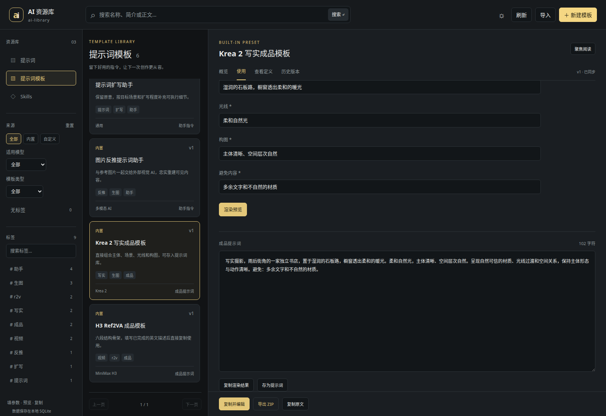
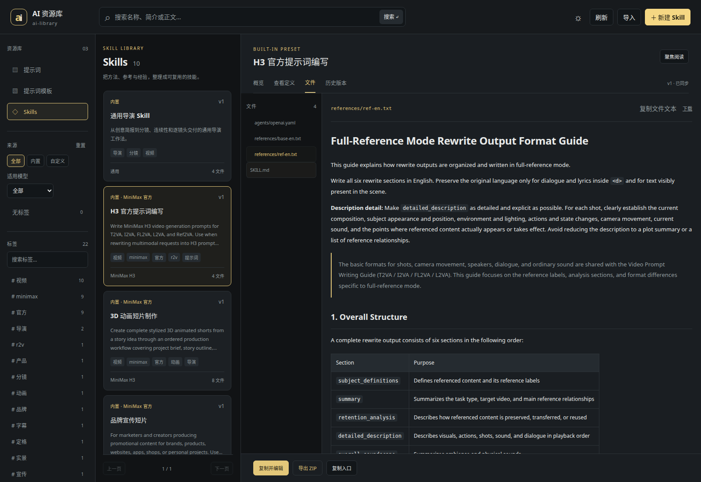

# 模板与 Skill 管理

## 数据保存在何处

内置预设的权威文件保存在仓库 `presets/`，随镜像发布。运行时会同步到数据库；自定义资源、标签、完整文件和历史全部存入同一个 SQLite。

容器内默认文件为 `/data/prompts.sqlite3`。默认部署使用 Docker 的 `library-data` 持久化卷；本机当前预览沿用配置目录 `data/preview/prompts.sqlite3`。文件名虽然保留 prompts，实际包含全部三类资源。

新增表：

| 表 | 内容 |
| --- | --- |
| `resources` | 当前模板 / Skill 内容及来源、当前版本 |
| `resource_versions` | 每次保存的完整内容快照 |
| `resource_tag_names`、`resource_tags` | 新资源的标签字典和关联，独立于普通提示词 |
| `file_blobs` | 按 SHA-256 去重的原始文件字节 |
| `resource_files` | 每个资源版本对应的文件路径与哈希 |

复制资源及恢复版本复用文件数据，不重复保存相同附件。数据库 backup 同时包含全部附件、标签和历史，不需要额外挂载 Skill 文件目录。

## 浏览与标签

从左侧选择提示词、模板或 Skills。模板 / Skill 可组合使用关键词、适用模型、内置或自定义、无标签及多个标签筛选。多个标签按全部匹配处理，数量只统计当前资源类型。

悬停卡片查看只读预览，点击阅读详情。长内容可选择“聚焦阅读”，窄屏在列表和工作区之间切换。内置项不能保存、删除或直接恢复；“复制并编辑”生成独立的自定义版本，不会随镜像升级被覆盖。

## 使用模板

1. 选择模板，打开“使用”。
2. 填写所需参数，点击“渲染预览”。
3. 复制结果。助手指令发给外部 AI；成品提示词可以直接用于目标模型，或点击“存为提示词”进入新建草稿。

这里不调用模型，不会凭空扩写文本、理解图片或生成视频。反推助手的图片需要在目标多模态 AI 中附加。试用输入不保存到历史；修改模板正文、变量、标签等并保存才形成新版本。

自定义模板通过“从正文提取变量”辅助建立变量表，再设置中文名称、类型、默认值、范围和必填要求。未声明的占位符、非法默认选项和缺少必填输入会明确报错。已修改但尚未保存的模板不能混用旧版本进行渲染。

## 使用 Skill

“概览”展示入口、来源和兼容性；有中文入口时可直接切换阅读。MiniMax 风格 Skill 中的 Hub 工具要求按原文展示，不表示资源库提供了这些工具。

“文件”展示完整相对路径。文本可编辑、Markdown 可预览、常见位图可查看，其他附件可下载。自定义 Skill 可添加和移除附件，必需的 SKILL.md 不能移除。多个文件及元数据一起保存，形成一次完整版本；脚本从不执行。

“复制入口”仅复制 SKILL.md；“复制完整文本上下文”默认包括入口、文本参考资料及文本素材模板，也可勾选其他文件。二进制内容使用 ZIP 导出。复制前可看到将包含哪些文件，不会静默截断内容。

## 版本与冲突

历史标签页可查看旧正文、变量、标签、文件清单和文件内容，或导出指定版本。恢复自定义资源会生成新版本；从内置旧版本编辑则创建新副本。

保存携带当前版本标识，发现其他客户端已修改时保留本地草稿，并提示重新加载。切换资源或离开页面时可保存、放弃或取消。导出 ZIP 是选定版本，完整历史保存在数据库备份中。

删除自定义资源会删除其历史，页面要求确认；仍被其他资源或版本引用的附件不会删除。上游移除的内置预设只归档，保留历史。

## 导入导出

- 模板支持 `.md`、库格式 ZIP。没有变量清单的 Markdown 会从占位符提取初始变量定义。
- Skill 支持单个技能 ZIP、目录上传或单个 SKILL.md。目录必须包含唯一 SKILL.md 入口。
- ZIP 附带 `ai-library.json` 库元数据和可安装的资源目录；原始文件字节、frontmatter、标签、变量及冻结参考文件均保留。导入生成新的自定义资源。
- 单文件最多 20 MiB，文件包最多 100 MiB、1000 个文件。拒绝路径穿越、重复路径、符号链接和加密包。异常导入不留下部分记录。

Markdown 禁用原始 HTML，并经过净化；外部图片不会自动加载，包内图片通过受控文件接口查看。文件可读取和下载，不提供执行入口。

## API

以下资源路径分别以 `/api/v1/templates` 和 `/api/v1/skills` 为前缀：

| 方法与后缀 | 用途 |
| --- | --- |
| `GET /` | `q`、重复 `tags`、`target_model`、`origin`、`untagged`、分页查询 |
| `GET /tags` | 当前类型的标签和无标签数量 |
| `POST /` | 创建自定义资源 |
| `GET /{id}`、`PATCH /{id}` | 完整详情与保存，保存携带 `version` |
| `DELETE /{id}?version=...` | 删除自定义资源及历史 |
| `POST /{id}/copy` | 携带当前 `version` 复制，可传 `number` 复制历史版本 |
| `GET /{id}/versions`、`GET /{id}/versions/{number}` | 版本列表和快照 |
| `POST /{id}/restore` | `version` 加历史 `number`，恢复为新版本 |
| `GET /{id}/files/{path}?number=...` | 原始文件或指定版本文件 |
| `GET /{id}/export?number=...` | ZIP 导出 |
| `POST /import` | Multipart，文件字段名均为 `files` |

模板另有 `POST /{id}/render`，输入 `values` 和可选 `version`，返回完整 `text` 及实际版本。Skill 另有 `POST /{id}/context`，接受可选 `paths` 和 `version`，返回全文及包含的文件路径。

创建 / 更新使用名称、简介、标签、模型、语言、正文、变量、`context_paths` 和文件变更。文件变更支持 `{"path":"references/guide.md","text":"..."}`、`base64` 或 `remove:true`。保存 SKILL.md 的两个编辑入口使用同一份草稿，不允许互相覆盖不一致的正文。

模板和 Skill 的保存、复制、恢复及预设同步不会改变现有 `/prompts/revision`，random 和 writer 接口保持兼容。
